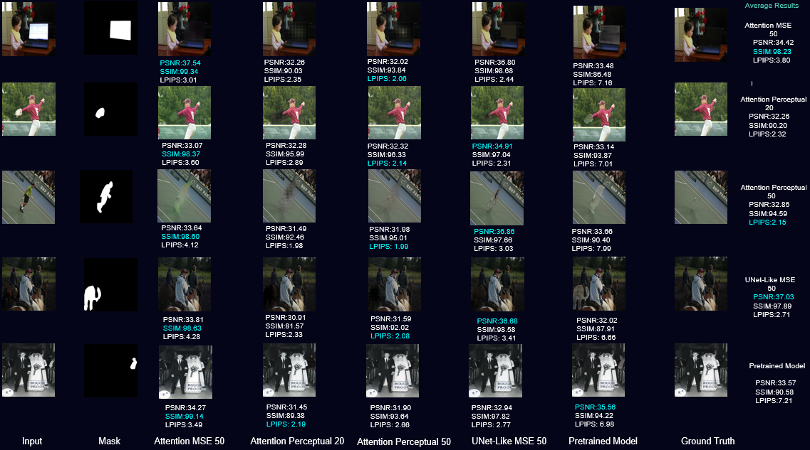
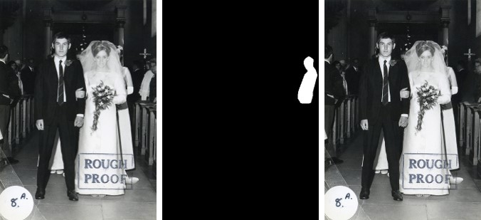
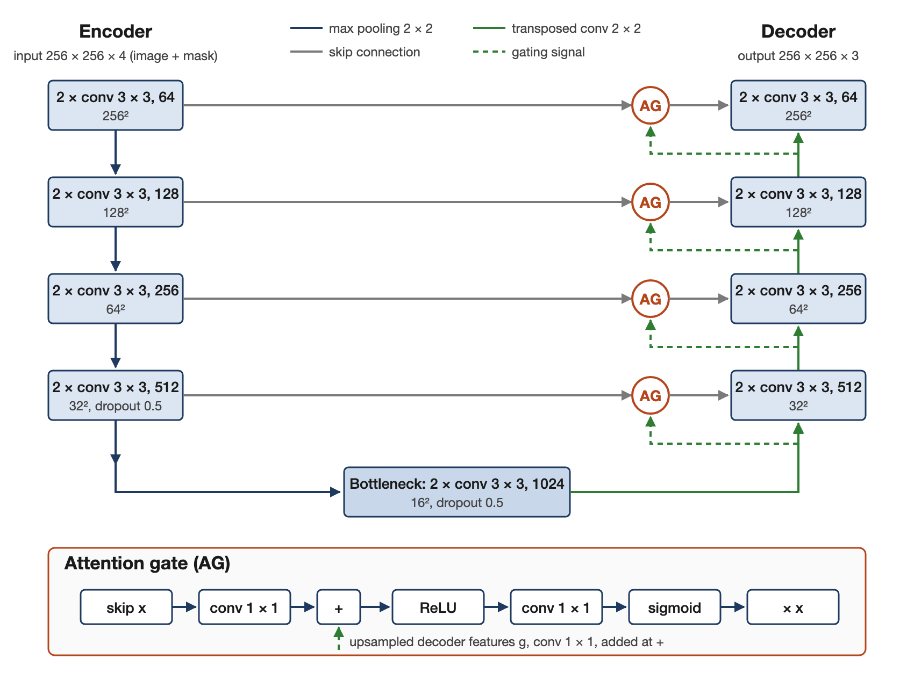

# IMPBÆ: Image Inpainting for Object Removal

Object-removal inpainting on the Defacto inpainting dataset (MSCOCO-based) with two encoder-decoder networks, a U-Net-like model and an Attention U-Net, trained with either MSE or a VGG19 perceptual loss at 256 × 256. No single configuration wins on every metric: the U-Net-like model with MSE has the highest PSNR (37.03 dB), the Attention U-Net with MSE has the highest SSIM (0.9823), and the Attention U-Net with perceptual loss trained for 50 epochs has the lowest LPIPS (0.0215). All four trained configurations score better on LPIPS than the pretrained baseline used for comparison in the report.

Course project for BLG513 Image Processing, Istanbul Technical University. Full write-up: [paper/ImageProcessingProjectReport.pdf](paper/ImageProcessingProjectReport.pdf).

## Results

Average test-set metrics, taken from Fig. 3 of the report. Best value per column in bold.

| Model | Loss | Epochs | PSNR (dB) ↑ | SSIM ↑ | LPIPS ↓ |
|-------|------|--------|-------------|--------|---------|
| U-Net-like | MSE | 50 | **37.03** | 0.9789 | 0.0271 |
| Attention U-Net | MSE | 50 | 34.42 | **0.9823** | 0.0380 |
| Attention U-Net | Perceptual (VGG19) | 20 | 32.26 | 0.9020 | 0.0232 |
| Attention U-Net | Perceptual (VGG19) | 50 | 32.85 | 0.9459 | **0.0215** |
| Pretrained baseline | – | – | 33.57 | 0.9058 | 0.0721 |

The figure prints SSIM as a percentage and LPIPS multiplied by 100; the table converts both back to the usual scale, which matches the values quoted in the report text (SSIM 0.98, PSNR 37 dB, LPIPS 0.0215). The report does not name the pretrained baseline.

**Attention gates.** `src/models/attention_unet.py` implements the gates described in the report (Section III-B, Fig. 2), re-implemented in November 2026 together with the architecture figure.



*Fig. 3 of the report. Columns, left to right: input, mask, Attention U-Net + MSE (50 epochs), Attention U-Net + perceptual (20 epochs), Attention U-Net + perceptual (50 epochs), U-Net-like + MSE (50 epochs), pretrained baseline, ground truth. Per-image PSNR / SSIM / LPIPS are printed under each output; the right-hand column lists the averages used in the table above.*

The MSE models lead on the pixel and structure metrics (PSNR, SSIM); the perceptual-loss models lead on LPIPS while losing 4 to 5 dB PSNR against the U-Net-like MSE model. The report also notes that training at 512 × 512 did not converge stably, so all results are at 256 × 256.

## Method

**Task.** The network receives the original image concatenated with a binary mask of the object to remove (4 channels, 256 × 256, values in [0, 1]) and predicts the 3-channel image with the object removed. The target is the inpainted image shipped with the dataset.



*Fig. 1 of the report: one dataset sample. Left to right: input image, binary mask of the region to remove, ground truth.*

**Data.** Defacto inpainting dataset, about 25,000 object-removal samples built on MSCOCO images. Each sample is an original image, a mask and a ground-truth inpainted image. The report describes the split as 30,000 training images and 3,000 each for validation and test, counted across input, mask and ground-truth files. The dataset as used here is on Kaggle: https://www.kaggle.com/datasets/bahakirbasoglu/defacto-inpainting-full-dataset

**Architectures.**

- `src/models/unet_like.py`: five encoder blocks (two 3 × 3 convolutions and 2 × 2 max pooling each; 64, 128, 256, 512, 1024 filters), four decoder blocks with transposed convolutions and skip concatenation, a final upsampling step and a 3 × 3 sigmoid output layer.
- `src/models/attention_unet.py`: four encoder levels (64 to 512 filters), a 1024-filter bottleneck, dropout 0.5 on the deepest encoder level and the bottleneck, transposed-convolution decoder, 1 × 1 sigmoid output. Each skip connection passes through an additive attention gate (Oktay et al., 2018): the encoder features and the upsampled decoder features are projected with 1 × 1 convolutions, summed, and reduced through ReLU, a 1 × 1 convolution and a sigmoid to a single-channel map that scales the encoder features before concatenation.



*Fig. 2 of the report: the Attention U-Net and its attention gate.*

**Losses.**

- MSE between prediction and ground truth (Keras `fit`).
- Perceptual loss (`src/training/trainer.py`, custom `GradientTape` loop): mean squared difference between VGG19 `block4_conv4` activations of prediction and ground truth, with ImageNet weights and VGG19 frozen.

**Training settings.** Adam, learning rate 0.001, batch size 32, image size 256 × 256 (`settings.json`, same values as in the report). The reported runs used an NVIDIA A100 GPU with 40 GB of memory. The `train_size`, `val_size` and `test_size` values committed in `settings.json` are 80 / 10 / 10, a small configuration for a quick run; the reported runs used the full split.

**Metrics.** PSNR, SSIM (scikit-image) and LPIPS (`lpips` package, AlexNet backbone by default), implemented in `src/evaluation/metrics.py`.

## Usage

```bash
pip install -r requirements.txt
```

**Data.** Download the Kaggle dataset and extract it to `Dataset/` so that the paths in `settings.json` resolve:

```
Dataset/original_images/                       original MSCOCO images
Dataset/inpainting_annotations/inpaint_mask/   binary masks
Dataset/inpainting_img/img/                    ground-truth inpainted images
```

`src/data/download.py` fetches the original MSCOCO images referenced by the Defacto annotation JSON files.

**Training.** Select the configuration with `training.model` in `settings.json`, then run:

```bash
python main.py
```

| `training.model` | Configuration |
|------------------|---------------|
| `UNetLikeMSE50` | U-Net-like, MSE, 50 epochs |
| `AttentionUNetMSE50` | Attention U-Net, MSE, 50 epochs |
| `AttentionUNetPerceptual20` | Attention U-Net, perceptual loss, 20 epochs |
| `AttentionUNetPerceptual50` | Attention U-Net, perceptual loss, 50 epochs |
| `ALL` | all four, sequentially |

The epoch count is fixed by the model identifier. Weights are written to `models/` and up to ten sample predictions to `predictions/`. Trained weights are not included in the repository.

**Inference.** A sample image and mask are in `test/imgs/`:

```bash
python test/script/infer.py \
  --image test/imgs/000000000260.jpg \
  --mask test/imgs/0_000000000260.tif \
  --model models/unet_mse_50.h5 \
  --visualize
```

White mask pixels mark the region to remove. `--output` sets the output path (default: `inpainted_<model>_img<image>.png`), `--visualize` also saves a side-by-side comparison.

**Evaluation.** Computes mean, standard deviation, minimum and maximum of PSNR, SSIM and LPIPS on the test split:

```bash
PYTHONPATH=. python src/evaluation/metrics.py --model models/unet_mse_50.h5
python src/evaluation/metrics.py --test    # metric sanity check on dummy data
```

## Repository layout

```
main.py            training entry point, reads settings.json
settings.json      model choice, batch size, learning rate, split sizes, paths
src/models/        unet_like.py, attention_unet.py
src/training/      trainer.py (perceptual-loss training loop)
src/data/          preprocess.py (load, resize, normalise), download.py (MSCOCO originals)
src/evaluation/    metrics.py (PSNR, SSIM, LPIPS)
test/script/       infer.py
test/imgs/         one sample image and mask
paper/             project report (PDF)
presentation/      final presentation (PPTX)
docs/              figures used in this README
```

## Report

[paper/ImageProcessingProjectReport.pdf](paper/ImageProcessingProjectReport.pdf): "IMPBA: Image Mask Prediction and Background-Aware Inpainting for Object Removal", Baha Kırbaşoğlu, Graduate Program in Computer Engineering, Istanbul Technical University. Slides: [presentation/ImageProcessingFinalPresentation.pptx](presentation/ImageProcessingFinalPresentation.pptx).

## License

MIT
